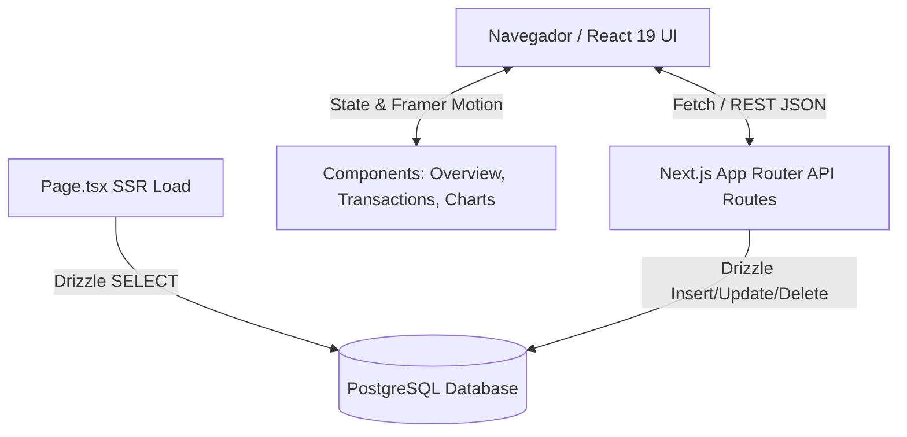

# 📊 Relatório de Análise Técnica — App Aurum (Track de Finanças Pessoais)

Este relatório apresenta uma análise detalhada da estrutura, código-fonte, arquitetura, dependências, rotas e estado funcional da aplicação **Aurum (Track de Finanças Pessoais)**.

---

## 🏗️ 1. Arquitetura do Sistema

A aplicação adota uma arquitetura moderna baseada em **Next.js 16 (App Router)**, combinando renderização no servidor (SSR) para carga inicial direta do banco de dados com componentes no cliente (Client Components) para alta interatividade visual.

### Principais Tecnologias e Camadas:
- **Framework Frontend & Server**: Next.js 16 (React 19, TypeScript).
- **Banco de Dados & ORM**: PostgreSQL acessado via `pg` (Pool de conexões) e `drizzle-orm` em [src/db/index.ts](file:///c:/Users/Administrator/.antigravity-ide/Track%20de%20Finan%C3%A7as%20Pessoais/src/db/index.ts).
- **Modelagem de Dados**: Declarada em [src/db/schema.ts](file:///c:/Users/Administrator/.antigravity-ide/Track%20de%20Finan%C3%A7as%20Pessoais/src/db/schema.ts):
  - `categories`: Categorias de despesas/receitas (ícone, cor, tipo).
  - `transactions`: Transações financeiras (descrição, valor em centavos `amountCents`, tipo, categoria, data ISO).
  - `budgets`: Limites de gastos por categoria.
  - `goals`: Metas de economia/acumulação de capital.
- **Estilização & Design System**: Tailwind CSS v4 com variáveis customizadas em [src/app/globals.css](file:///c:/Users/Administrator/.antigravity-ide/Track%20de%20Finan%C3%A7as%20Pessoais/src/app/globals.css), usando paleta escura premium (`#060807`), efeito de film grain e iluminação atmosférica.
- **Animações & Data Viz**: `framer-motion` e visualizações customizadas em SVG puro sem bibliotecas pesadas de gráficos em [src/components/charts.tsx](file:///c:/Users/Administrator/.antigravity-ide/Track%20de%20Finan%C3%A7as%20Pessoais/src/components/charts.tsx).
- **Popularização de Dados (Seed)**: Script determinístico [src/db/seed.ts](file:///c:/Users/Administrator/.antigravity-ide/Track%20de%20Finan%C3%A7as%20Pessoais/src/db/seed.ts) usando algoritmo PRNG *mulberry32* para simular 6 meses de transações realistas.

---

## ✨ 2. Funcionalidades do App

| Módulo | Descrição / Recursos | Arquivos Principais |
| :--- | :--- | :--- |
| **Dashboard Principal** | Saldo acumulado com gráfico Sparkline de 6 meses; KPIs de Entradas/Saídas do mês com comparativo percentual ($\Delta$) em relação ao mês anterior; Taxa de Poupança calculada automaticamente. | [overview.tsx](file:///c:/Users/Administrator/.antigravity-ide/Track%20de%20Finan%C3%A7as%20Pessoais/src/components/overview.tsx) |
| **Navegação Temporal** | Permite avançar ou voltar pelos meses históricos recalculando instantaneamente os balanços e filtragens. | [finance-app.tsx](file:///c:/Users/Administrator/.antigravity-ide/Track%20de%20Finan%C3%A7as%20Pessoais/src/components/finance-app.tsx) |
| **Fluxo de Caixa (Chart)** | Gráfico de linhas/áreas suavizadas em SVG com guias de rastreamento e *tooltip* flutuante ao passar o mouse. | [charts.tsx](file:///c:/Users/Administrator/.antigravity-ide/Track%20de%20Finan%C3%A7as%20Pessoais/src/components/charts.tsx) |
| **Distribuição de Gastos** | Gráfico Donut em SVG categorizando despesas com destaque iterativo e percentuais de participação. | [charts.tsx](file:///c:/Users/Administrator/.antigravity-ide/Track%20de%20Finan%C3%A7as%20Pessoais/src/components/charts.tsx) |
| **Gestão de Orçamentos** | Lista de metas de gastos por categoria com barras de progresso dinâmicas (Verde $<80\%$, Amarelo $\ge 80\%$, Vermelho estourado) e edição rápida de limites. | [overview.tsx](file:///c:/Users/Administrator/.antigravity-ide/Track%20de%20Finan%C3%A7as%20Pessoais/src/components/overview.tsx) |
| **Metas Financeiras** | Acompanhamento de progresso com anéis circulares e função de aporte rápido (+R$ 100, +R$ 500, +R$ 1.000 ou valor customizado). | [overview.tsx](file:///c:/Users/Administrator/.antigravity-ide/Track%20de%20Finan%C3%A7as%20Pessoais/src/components/overview.tsx) |
| **Lançamento de Transações** | Modal interativo para adicionar/editar receitas ou despesas com validação de campos e valor formatado em reais (BRL). | [transaction-modal.tsx](file:///c:/Users/Administrator/.antigravity-ide/Track%20de%20Finan%C3%A7as%20Pessoais/src/components/transaction-modal.tsx) |
| **Visão de Transações** | Lista agrupada por dia, com busca por descrição/categoria, filtros por tipo (Receita/Despesa), filtro por Categoria e exclusão em tempo real. | [transactions-view.tsx](file:///c:/Users/Administrator/.antigravity-ide/Track%20de%20Finan%C3%A7as%20Pessoais/src/components/transactions-view.tsx) |

---

## 🚨 3. Erros, Inconsistências e Falhas Encontradas

### 🔴 Críticos (Bloqueantes / Configuração)

> [!CAUTION]
> **1. Ausência do diretório `node_modules`**
> As dependências do projeto não estão instaladas no ambiente. Comandos como `npm run dev`, `npm run build` ou checagens de tipo falham até que `npm install` seja executado.

> [!WARNING]
> **2. Incompatibilidade em [tsconfig.json](file:///c:/Users/Administrator/.antigravity-ide/Track%20de%20Finan%C3%A7as%20Pessoais/tsconfig.json#L20)**
> O arquivo de configuração do TypeScript inclui `"baseUrl": "."`. Nas versões mais recentes do TypeScript, a propriedade `baseUrl` foi descontinuada quando utilizada com bundlers modernizados, gerando o erro `TS5102: Option 'baseUrl' has been removed`.
> *Solução*: Remover a linha `"baseUrl": "."` mantendo apenas a propriedade `"paths": { "@/*": ["./src/*"] }`.

> [!NOTE]
> **3. Nome genérico em [package.json](file:///c:/Users/Administrator/.antigravity-ide/Track%20de%20Finan%C3%A7as%20Pessoais/package.json#L2)**
> O projeto se apresenta ao usuário como `"aurum"`, porém o manifesto do repositório ainda preserva o nome padrão de template `"name": "nextjs-postgresql-template"`.

---

### 🟠 Falhas de Arquitetura e APIs (Backend)

1. **Incompletude das Rotas CRUD da API**:
   - **Metas**: A rota [src/app/api/goals/[id]/route.ts](file:///c:/Users/Administrator/.antigravity-ide/Track%20de%20Finan%C3%A7as%20Pessoais/src/app/api/goals/%5Bid%5D/route.ts) aceita apenas `PATCH` para aportes (`addCents`). Não há endpoints `POST /api/goals` nem `DELETE /api/goals/[id]`. O usuário não consegue criar novas metas nem remover metas concluídas pela interface.
   - **Orçamentos**: A rota [src/app/api/budgets/[id]/route.ts](file:///c:/Users/Administrator/.antigravity-ide/Track%20de%20Finan%C3%A7as%20Pessoais/src/app/api/budgets/%5Bid%5D/route.ts) aceita apenas `PATCH`. Se uma categoria não tiver um orçamento previamente cadastrado no seed, não é possível criar um novo limite via UI.
   - **Categorias**: Não existem rotas de gestão de categorias (`/api/categories`).
2. **Ausência de Autenticação / Multi-inquilino (Multi-tenant)**:
   - A aplicação faz busca global de dados (`db.select().from(...)`) sem vincular transações ou metas a um `userId`.
3. **Resiliência de Conexão com o Banco**:
   - A página principal `src/app/page.tsx` está configurada como `export const dynamic = "force-dynamic"`. Caso o serviço do PostgreSQL não esteja em execução na porta `5432` ou a variável `DATABASE_URL` não esteja acessível, a aplicação lança uma exceção não tratada (Error 500) sem fallback gracioso.

---

### 🟡 Inconsistências de Frontend e UX

1. **Revalidação por `router.refresh()`**:
   - No componente [finance-app.tsx](file:///c:/Users/Administrator/.antigravity-ide/Track%20de%20Finan%C3%A7as%20Pessoais/src/components/finance-app.tsx#L65-L113), todas as atualizações (salvar/deletar transação, editar orçamento, aportar meta) chamam `router.refresh()`. Embora atualize os dados do servidor, esse padrão provoca requisições completas de re-renderização SSR, podendo desincronizar animações locais e causar pequenos atrasos. O uso de gerenciamento de estado otimista (*Optimistic UI*) traria uma experiência mais fluida.
2. **Sem Paginação ou Virtualização nas Transações**:
   - Em [transactions-view.tsx](file:///c:/Users/Administrator/.antigravity-ide/Track%20de%20Finan%C3%A7as%20Pessoais/src/components/transactions-view.tsx), a lista renderiza todas as transações do mês de uma só vez no DOM. Em meses com alto volume de movimentações, isso pode causar gargalos de performance no navegador.

---

## 📝 4. Quadro de Pendências e Roadmap de Melhorias

- [x] **Ambiente & Build**: Executar `npm install` e corrigir a linha `baseUrl` em `tsconfig.json`.
- [x] **Expansão de APIs REST**:
  - Implementar `POST /api/goals` e `DELETE /api/goals/[id]`.
  - Implementar `POST /api/budgets` e `DELETE /api/budgets/[id]`.
  - Implementar gestão de categorias (`POST / GET / DELETE /api/categories`).
- [x] **Recursos Adicionais (Roadmap)**:
  - Adicionar suporte a exportação de relatórios em formato CSV e PDF.
  - Adicionar transações recorrentes e parcelamento de compras.
  - Implementar suporte a autenticação de usuários (ex: Clerk ou NextAuth).
